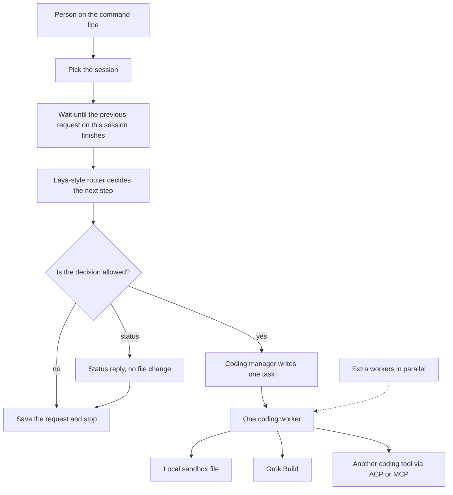

# Architecture

OpenCodingPartner handles one request at a time. It picks the session, decides what to do, writes a short plan, then one coding worker runs that plan. Chat is only the log of that request.



Two open-source projects sit behind this:

- The control plane follows the [OpenClaw](https://github.com/openclaw/openclaw) gateway: one process owns sessions, channels, and routing. We do not ship OpenClaw.
- [Grok Build](https://github.com/xai-org/grok-build) is the coding worker. Another tool can plug in later through ACP or MCP. If this version names that plug, the name is Grok Build.
- The local sandbox worker edits a folder on this machine. It is the offline stand-in, not a third upstream.

The dotted line is where extra workers could run in parallel. That path is off. `speculativeSwarm` is false, and `maxWorkersPerTurn` is 1. A plan with more than one task does not run.

## Who does what

| Piece | Does | Does not |
| --- | --- | --- |
| Gateway | Picks the session and allows one worker | Write the plan or edit a file |
| Router | Chooses the next step: decline, ask again, answer, or dispatch | Write text or a diff. Laya does this when its weights are loaded |
| Conversation manager | Status reply | Start a worker |
| Coding manager | One `write_file` task when the person named the path and the text | Invent a change or call a second worker |
| Coding worker | Runs that one task | Choose the next step |

A chat model, when one is configured, is a manager. Grok Build and the local sandbox are workers. Laya is System-1: it only picks the route. Laya is about 421 million parameters. That size is for the route, not for writing code.

## Session

This build has one entry, matching the way OpenClaw maps a channel to an agent:

| Channel | Account | Agent | Session key |
| --- | --- | --- | --- |
| `cli` | `local` | `board` | `agent:board:main` |

OpenClaw's docs are the reference, not code we vendor. Their gateway is one long-lived process with a WebSocket API. See [Gateway architecture](https://docs.openclaw.ai/concepts/architecture), [multi-agent routing](https://docs.openclaw.ai/concepts/multi-agent), and the [agent loop](https://docs.openclaw.ai/concepts/agent-loop). A later phase turns our in-process queue into that process. The steps below stay the same.

Requests on one session key run one at a time. The same idempotency key returns the saved result and does not write again.

## One request

1. Pick the session and enter its queue.
2. Ask the router every question in one `predict` call.
3. `evaluateRoute` accepts the answers or stops. A dispatch stops when `needs_human` is 0.5 or higher, or when the labels disagree.
4. On `answer`, the conversation manager returns a status plan with no tasks.
5. On `dispatch`, the coding manager returns a plan. The gateway allows it only when it has exactly one `write_file` task and the worker matches the route.
6. The gateway calls `CodingWorker.dispatch` once, in `packages/gateway`.
7. A sandbox path must stay inside the sandbox. Then the request is saved.

Decline and clarify stop before a file is planned. If Grok Build has no runner injected, it throws before any process starts. That failure is not saved, so a later retry can run after a runner is added.

Saved events: `session.resolved`, `policy.predicted`, then `control.blocked` or `manager.planned`, then `worker.skipped` or `worker.dispatched` and `worker.finished`, then `turn.completed`.

## Router

Questions use Laya's three public types (`choice`, `score`, `noul`). Answers use the public fields: `choice` with `probabilities` and `confidence`, `score` with `legend`, and `noul` as the probability the statement is true. See [`laya::Answer`](https://docs.rs/laya/latest/laya/enum.Answer.html) and `Router.predict(state, questions)` in [PyPI `laya` 0.3.7](https://pypi.org/project/laya/0.3.7/).

Checkpoints we will call, and do not bundle:

| Router name | Hub id | Size | Use |
| --- | --- | --- | --- |
| `english` | `convaiinnovations/laya` | 421M, ModernBERT-large | Default for these English questions |
| `multilingual` | `convaiinnovations/laya-multilingual` | 322M | When the text is not English |
| `typed-decisions` | `convaiinnovations/laya-typed-decisions` | 421M | Only if a later question set matches that workflow |

This build uses `MockLayaPolicyRouter`. `routing.backend` is `mock-heuristic`, `routing.repo` is null, and token counts are zero. The confidence numbers fill the schema. They are not a model run.

`LayaCheckpointRouter` calls a bridge and sets `routing.backend` to `laya`. The bridge is a command, not a process we start:

```text
python3 integrations/laya/predict.py
```

The script reads `{ "state", "questions", "model" }` on stdin and runs:

```python
from laya import Router
router = Router()
result = router.predict(state, questions, model=model)
```

The first `Router()` call can download weights into the operator's cache. This repo does not call a hosted Laya URL.

If a live checkpoint returns labels the gateway does not accept, `evaluateRoute` does not start a worker.

## Managers

`parseManagerPlan` checks the plan. A plan that fails the check never reaches a worker. A dispatch plan has one task. The path is relative to the sandbox. Absolute paths and `..` fail in the parser and again in the worker.

The offline coding manager accepts only:

```text
create RELATIVE_PATH with content:
<bytes>
```

A later manager can be a chat model the operator configures. It must return this same JSON. Free-form chat text is not a plan.

## Workers

`CodingWorker` takes one task and returns a result.

### Local sandbox

`LocalSandboxWorker` creates the folder, writes a temporary file beside the target, and renames it into place. The gateway checks the result path is still inside the sandbox.

### Grok Build

Grok Build is the Apache-2.0 coding agent at [xai-org/grok-build](https://github.com/xai-org/grok-build). Headless mode is `grok -p "<prompt>" --output-format streaming-json` ([overview](https://docs.x.ai/build/overview), [headless guide](https://github.com/xai-org/grok-build/blob/main/crates/codegen/xai-grok-pager/docs/user-guide/14-headless-mode.md)). ACP (`grok agent stdio`) is the later two-way interface. This build records the headless command first.

`buildGrokHeadlessInvocation` returns that command and a working directory. `GrokBuildCodingWorker` runs it only through an injected runner. This package does not import `node:child_process`, so it cannot start `grok` by accident.

## Limits

```typescript
ads: false
payments: false
speculativeSwarm: false
maxWorkersPerTurn: 1
```

`packs/enterprise` reserves a name for a later consult or enterprise pack. It has no code, no price, and no meter.

## Independence

OpenCodingPartner does not ship OpenClaw, Grok Build, or Laya. The names above are citations. Operators who use those projects install them, accept their licenses, and supply their own credentials.
