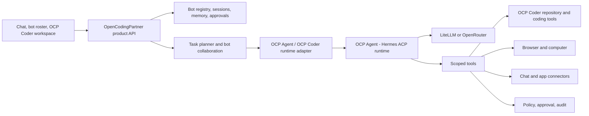

# OpenCodingPartner: Product and Architecture Bible

## Product thesis

OpenCodingPartner (OCP) is an open, provider-neutral ecosystem for creating and working with persistent AI teammates, centered on **OCP Agent** and **OCP Coder**. A person creates named bots with a role, instructions, memory, tools, and a workspace, then gives them work through chat or an automation. A bot can plan, use tools, collaborate with other bots, make changes in a project, verify its work, and return for approval when a decision or risk requires the human.

The product inspiration is the *AI teammate* experience associated with Grok Bot: persistent agents that do work across tools, keep context, and collaborate. OpenCodingPartner makes that experience buildable and self-hostable through **OCP Agent** (powered by Hermes Agent under the hood) and **OCP Coder**, with model access through LiteLLM or OpenRouter. This is a product reference, not an affiliation, compatibility claim, or attempt to reproduce proprietary Grok Bot internals. See [xAI's Grok Bot announcement](https://x.ai/news/introducing-grok-bot).

The ecosystem includes both the **OCP Agent** teammate platform and **OCP Coder** as a first-class coding teammate. Coding is not a separate demo utility or a disconnected application: **OCP Coder** is part of the same identity, conversation, memory, tool, approval, and provider system. A user can switch a bot's model/provider without changing how they interact with it.

## Product promises

- **Bots are durable teammates.** Each has a stable identity and role, persistent conversation context, explicit workspace, reusable instructions, tools, and status. A bot survives process restarts; a turn is not the bot's identity.
- **Bots finish work.** Responses can include artifacts and verified changes, not only advice. **OCP Coder** inspects a repository, edits files, runs bounded checks, and reports what changed.
- **Bots can work as a team.** A lead bot can delegate bounded tasks to specialist bots, coordinate handoffs, and assemble a result. Multi-agent work is a user capability, not an arbitrary fixed four-agent demo.
- **The computer is a tool surface.** Browser and desktop actions belong to a bot's workspace/runtime and produce inspectable evidence. Human takeover and approval remain possible.
- **Provider choice is a first-class setting.** LiteLLM is the preferred self-hosted gateway and policy/budget point; OpenRouter is a hosted multi-provider option. Direct compatible endpoints may be supported. Provider/model configuration is separate from bot identity and tool permissions.
- **Humans retain control.** Dangerous or externally consequential actions can require approval. Permissions are scoped and visible; audit history records plans, tool calls, checks, approvals, and outcomes.
- **Open core, portable data.** Core bot definitions, conversations, workspace metadata, and tool contracts use documented formats. Optional hosted services must not be required for local use.

## Target architecture

**OCP Agent** (powered by Hermes Agent ACP) is the **agent execution runtime**: it owns the model/tool loop, tool calling, and agent-level interaction. OpenCodingPartner is the **product layer** around **OCP Agent** and **OCP Coder**: bot roster and identity, workspaces, persistence, UI/chat surfaces, permissions, orchestration, approvals, audit trail, and integrations.



### Responsibility boundaries

| Layer | Owns |
| --- | --- |
| Product experience | Bot roster, bot creation/configuration, chat, task handoff, status, approvals, **OCP Coder** workspace, settings |
| Product core | Stable bot/task/session models, persistence, workspace lifecycle, permission policy, audit events, integrations |
| Orchestration | Decide whether work stays with one bot or delegates; define tasks, dependencies, and handoffs; collect results |
| **OCP Agent** / **OCP Coder** adapter | Run an agent turn, provide model/tool-loop behavior, stream structured events, expose cancellation and errors |
| Model gateway | LiteLLM or OpenRouter handles provider/model routing, keys, fallback, usage and budgets; it does not define bot identity or application workflow |
| Tools | Coding, filesystem, tests, browser/computer, search, and connectors behind scoped, auditable contracts |

**OCP Agent** uses Hermes Agent's multi-provider inference support, including OpenRouter and OpenAI-compatible endpoints; configuration follows its [provider documentation](https://hermes-agent.nousresearch.com/docs/integrations/providers/). OpenRouter documents Hermes setup and provider routing in its [Hermes guide](https://openrouter.ai/blog/tutorials/hermes-agent/). These are integration options, not a reason to couple product data to either provider.

## Core domain objects

- **Bot:** stable ID, display name, role/persona, runtime settings (`ocp-agent` or `ocp-coder`), model preference, tool grants, workspace assignment, memory policy, lifecycle status, and timestamps.
- **Task:** user goal, originating bot/user, plan, status, approval requirements, deadline/cancellation, and final outcome.
- **Session:** durable conversation between a human and a bot (or team), with messages and links to tasks and artifacts.
- **Run:** one execution attempt for a task/session; records selected runtime/model route, events, tool calls, usage, and result. Retries create runs rather than erasing history.
- **Workspace:** isolated project/filesystem context with explicit read/write boundaries and optional computer/browser state.
- **Artifact:** output file, patch, report, screenshot, or other result tied to a run and workspace.
- **Approval:** a human decision attached to a specific proposed action or plan, including what is being approved and its scope.
- **Tool grant:** permission to invoke a tool against a defined resource. The model does not grant itself access.

Persist bot identity and product state independently from underlying runtime process state. Keep conversation/memory storage replaceable and make workspace files inspectable. Do not use one global session key as the identity for every bot.

## Main user flows

### Create and run a bot

1. The user creates or selects a bot (**OCP Agent** or **OCP Coder**) and chooses its role, workspace, model/provider, and tool permissions.
2. The product opens or resumes that bot's durable session and creates a task/run for new work.
3. The orchestrator passes bounded instructions and granted tools to the runtime adapter.
4. Runtime events stream into the product transcript and audit log. Tool requests pass through product policy before execution.
5. The bot returns a result and linked artifacts. The product persists the outcome and updates bot/task status.

### Build software with OCP Coder

**OCP Coder** uses the same lifecycle as other bots in the **OCP Agent** ecosystem. It gets a repository workspace, scoped file and shell/check tools, and relevant project instructions. It inspects before editing, proposes a plan when useful, edits through guarded tools, runs explicitly permitted checks, and reports files changed plus check results. The QA/review role may be a specialist bot or a bounded delegated task. A coding session retains its own conversation and project context across turns. OpenCodingPartner does not maintain a disconnected product just for code generation.

The current local dashboard shows task activity, results, approvals, changed paths, and a bounded Git diff. Selecting a changed path opens its current workspace contents through the same guarded reader used by the coding workspace tools. The reader enforces the workspace boundary, refuses symlink paths and secret-like files/content, and caps reads at 500 KB. This is a review aid for the current local prototype; it is not a versioned artifact store or a historical snapshot of file contents.

The dashboard also provides a bot-centered conversation assembled from that bot's persisted task requests and responses. New requests continue the bot's saved **OCP Agent** session, while task-specific approvals, status, and review data remain attached to their originating task. This transcript is reconstructed from local task history; it is not a direct export of the runtime conversation store.

Failed, cancelled, and `needs-attention` tasks can be retried from the dashboard as new task records. The original remains available for review; the UI warns that the previous run may have left partial workspace changes.

Bot definitions can be deleted from the local dashboard or CLI when they have no queued or active work. Deletion preserves task records and **OCP Agent** session files so task history remains referentially useful and local session data is not removed as a side effect. There is not yet a bot archive/unarchive or explicit session cleanup workflow.

Task recovery runs under the local state lock. When the recorded owner process is gone, an active task becomes `needs-attention`, loses its stale approval request, and receives a recovery event; new task creation performs this check before workspace-conflict detection. On Linux the task also stores the owner's boot ID and process start ticks to distinguish PID reuse. Other platforms fall back to conservative PID liveness, so an unrelated live process with a reused PID may delay recovery but is not incorrectly interrupted.

The local app shutdown path first closes the request gate, then aborts and drains active runs. A task request already in flight during shutdown is either included in the drain or recorded as cancelled before it can launch a runtime. This avoids leaving a task owner process alive after the UI server exits.

`ocp backup --to PATH` copies local bot/task state and per-bot **OCP Agent** profiles under the state lock. It refuses active runs, symbolic links, and existing or overlapping destinations. Workspace repositories stay in their assigned paths and are not included. The backup contains private prompts, results, instructions, endpoint metadata, and runtime session data; it is user-managed and unencrypted. `OCP_DATA_DIR` can point the application at the backup directory on the same machine.

`ocp restore --from BACKUP_DIR --to NEW_DATA_DIR` restores a backup only into a new directory. Optional workspace-root remapping updates bot assignments after verifying destination workspaces exist and clears the affected bots' runtime session IDs. Workspace files are never copied by OCP. Historical task records stay intact; they continue to describe the original runs.

### Delegate to a bot team

A lead bot or the product orchestrator breaks a goal into tasks with clear ownership and dependencies. Specialist bots receive only the context and tools needed for their task. Handoffs are explicit and persisted. The lead bot reconciles outputs and asks the user when goals conflict, a permission is missing, or an approval is required. Parallelism is a scheduling decision, not an assumption that every request needs every role.

### Human approval and computer use

Tool policy classifies actions by scope and impact. Reads and low-risk workspace edits may be allowed by grant; external messages, account changes, publication, purchases, destructive operations, and other configured high-impact actions require approval. The approval must bind to the proposed action and relevant arguments. Browser/computer execution uses the bot's isolated workspace, has visible ownership/takeover state, and saves evidence. A failed check or denied action is recorded and surfaced; it is not silently treated as success.

## Provider and runtime strategy

```text
Bot configuration -> OCP Agent adapter -> OCP Agent (Hermes ACP) -> configured endpoint
                                                                 -> LiteLLM (self-host/routing) -> providers
                                                                 -> OpenRouter (hosted routing) -> providers
```

- Keep provider credentials in the operator's secret store/environment, never bot prompts, transcripts, or repository files.
- Let LiteLLM/OpenRouter route model requests; keep task planning, bot identity, permissions, and durable state in OpenCodingPartner.
- Support per-bot model preferences while allowing an administrator to set defaults, allowed models, budget limits, and fallback policy.
- Record the provider/model route and usage metadata for each run without exposing keys.
- Treat provider APIs and runtime interfaces as replaceable adapters. Avoid provider-specific behavior in core domain types.
- Do not make xAI/Grok the default or a product dependency. The “Grok Bot” reference describes the teammate experience, not the required model.

## Current repository: implemented foundation

This repository is an early product prototype, not yet the target product above. It now has a local browser dashboard, durable bot/task state, isolated **OCP Agent** profiles for explicit OpenRouter/LiteLLM bots, Docker-backed **OCP Agent** tool execution, task history, cancellation, and one-action approvals. It still lacks a complete product UI, secret-store integration, container isolation for standalone `ocp-coder` runtime processes, and team orchestration built on durable task records.

| Package/path | Current role | Target direction |
| --- | --- | --- |
| `packages/cli` | `ocp` command parser, chat REPL, and loopback app entry point | Keep CLI useful while building a fuller app UI against product services |
| `packages/gateway` | `runChatTurn` coordinates route, plan, local swarm, approvals, QA, computer, transcript | Split durable product/task services from the current large turn coordinator; make runtime adapter the execution boundary |
| `packages/policy` | Laya/fallback selects status or a fixed set of roles | Keep policy where useful; routing should select bot/task workflow and permissions, not define the whole product |
| `packages/swarm` | In-memory stand-up/list/dispatch of role records | Replace or evolve into durable bot registry and task orchestration; do not confuse role records with running independent agents |
| `packages/workers` | Local coding, security, QA, and computer implementations; coding and OpenAI-compatible runners | Preserve valuable tool/policy functions behind **OCP Agent** / **OCP Coder** tool contracts; coding is a bot capability, not a disconnected app |
| `packages/mesh` | Shared role and session types | Evolve into stable product domain contracts for bots, tasks, runs, sessions, grants, and events |
| `packages/product` | Local JSON bot/task registry, **OCP Agent** & **OCP Coder** ACP runtime, task event history, and loopback dashboard server | Grow into durable product services, runtime lifecycle, provider and credential management, and team orchestration |
| `packages/bundle` | Installs/probes legacy stack binaries; LiteLLM-compatible coding path | Add/replace with **OCP Agent** runtime setup and provider configuration; retain OpenClaw only as an optional integration if it adds value |
| `integrations/openclaw-sandbox-write` | OpenClaw plugin plus loopback bridge for guarded sandbox writes | Keep the security boundary; decouple it from OpenClaw and expose guarded tool contracts to **OCP Agent** |

Current code facts:

- `runChatTurn` is serialized on the shared `agent:board:main` lane and caches completed results in process memory. That is not durable per-bot identity or task persistence.
- `OrchestrationSwarm` stands up in-memory role records. It does not run a durable fleet of **OCP Agent** teammates.
- The legacy coding path can use LiteLLM credentials or an OpenAI-compatible endpoint, but this is a coding worker adapter, not application-wide model configuration for persistent bots.
- `packages/product` stores bot/task state under the OS user data directory (or `OCP_DATA_DIR`) and resumes an ACP session per bot. **OCP Agent** tool execution uses its Docker terminal backend by default and mounts the selected workspace at `/workspace`; `--isolation host` explicitly disables that. Explicit OpenRouter and LiteLLM bots get separate **OCP Agent** homes with provider/model configuration; provider keys are resolved from the run environment and are not persisted. Interactive CLI runs can approve an individual ACP action once; non-interactive runs cancel permission requests. Approval outcomes are recorded on the task.
- **OCP Agent** ACP sessions receive an OCP workspace MCP server backed by the existing `packages/workers` coding utilities. It offers bounded list/read/grep/glob, create, patch, append, copy, rename, delete, and directory tools (file reads and mutations capped at 500 KB); it blocks `.ocp/`, `gtm/`, symlink paths, path escapes, and secret-pattern content. The bridge runs as a local host process, not inside **OCP Agent**'s Docker terminal container; command execution remains in the Docker terminal. This is the first concrete integration between the durable bot/task app and the guarded **OCP Coder** tool foundation, not yet a complete shared coding UI.
- Docker-backed **OCP Agent** bots disable terminal-container network egress by default and can explicitly enable it per bot; provider requests and the workspace MCP bridge remain host processes, so this setting is not a whole-app air gap.
- Built-in roles have editable default operating instructions shared by the dashboard and CLI. Coding (**OCP Coder**), QA, security, research, and computer presets set distinct scopes and reporting expectations; assigning a role is a starting configuration, not a separate runtime or an automatic multi-agent workflow.
- ACP assistant-message chunks are coalesced and persisted to the task while it runs; the dashboard shows a live response, and task results are capped at 20 KB in product state.
- Dashboard and CLI coding tasks can hand off sequentially to one QA or security bot in the same workspace. The reviewer gets the original request, implementation report, changed paths, and a bounded diff; both bot sessions remain separate while the task records one combined result and handoff event. This is an initial fixed workflow, not dynamic team orchestration.
- Workspace paths are canonicalized on bot creation/reconfiguration, and active-task overlap checks resolve real paths while holding the shared state lock so symlink aliases cannot schedule concurrent writers to the same directory.
- Tasks snapshot each participating bot's ID, name, role, runtime, provider, model, and non-credential endpoint when queued; the audit record is stable if the bot is reconfigured later.
- Inactive task records can be removed from OCP local state through the dashboard or CLI; active tasks are protected. This does not delete **OCP Agent**'s separate conversation database.
- CLI task runs handle SIGINT/SIGTERM by aborting the active ACP child, resolving any pending terminal approval, and persisting `cancelled`; ACP children escalate from SIGTERM to SIGKILL after a bounded delay.
- A task is not marked complete when the ACP prompt response arrives; OCP closes stdin, waits for the child to exit, then uses a five-second graceful-shutdown window and bounded kill escalation before releasing the task/workspace lock.
- Tasks capture Git changed paths and a bounded diff at the start/end of each run. Pre-existing workspace edits are called out, untracked file contents are excluded, and the existing secret scanner can suppress a diff.
- `ocp app` serves a local dashboard on loopback. It creates/configures bots, launches and cancels tasks, displays bounded task activity, handles one-action approvals, and checks executable/daemon/key presence without printing credential values or sending prompts. Bot configuration changes are blocked while work is active and clear the saved runtime session when execution settings change. Mutating API calls require an in-memory token delivered to the same-origin page; host and origin checks reject requests from other origins.
- **OCP Agent** and **OCP Coder** ACP processes themselves still run locally with the user's OS permissions. Standalone `ocp-coder` runtime processes do not use the **OCP Agent** Docker terminal boundary.
- The `ocp bot` / `ocp task run` path launches an **OCP Agent** (`hermes acp`) or **OCP Coder** (`grok agent stdio`) process through ACP and stores a session ID per bot. The older `ocp chat` turn coordinator still uses the legacy fixed-role swarm and worker flow; it has not yet migrated to this runtime path.
- OpenClaw may own a session plan and invoke the write bridge. Local orchestration otherwise runs in this process. This is the current architecture and should not dictate the target product boundary.
- Security checks, sandbox operations, file QA, computer action recording, approval cards, partner workspaces, and channel adapters are existing assets to reuse or adapt.

## Architecture principles

1. **One ecosystem, one bot model.** **OCP Agent** and **OCP Coder** share identity, session, task, tool, and provider configuration. Specialization is configuration and grants, not disconnected applications.
2. **OCP Agent executes; OpenCodingPartner productizes.** Integrate the Hermes-based **OCP Agent** runtime for agent execution. Do not duplicate its agent loop in a separate coding loop or let a single process own the whole product's durable identity and UI.
3. **Durability first.** Store bot, session, task, run, approval, and audit state in durable storage. Process restarts must not erase the roster or history.
4. **Events over transcript scraping.** Use structured runtime events/tool calls where **OCP Agent** supports them. Keep a compatibility adapter if an initial CLI integration requires parsing output; do not make parsing human-formatted text the permanent protocol.
5. **Tools are guarded capabilities.** Tools receive explicit resource scope, validated arguments, bounded execution, and structured results. No agent gets ambient access to the host or secrets.
6. **Human control is part of the model.** Approval, denial, cancellation, and takeover are domain operations with persisted state and audit evidence.
7. **Provider-neutral core.** LiteLLM and OpenRouter are first-class connection paths. Core records provider/model as run metadata, not implementation-specific logic.
8. **Observable work.** A user can see what a bot is doing, what it changed, which checks ran, what failed, and what awaits them.
9. **Incremental migration.** Preserve working policy/security/tool code where possible; replace architectural seams deliberately rather than rewriting every worker at once.

## Phased direction

### 1. Harden the OCP Agent & OCP Coder runtime boundary

The first ACP process adapter and local bot/task records are implemented. Validate them against installed **OCP Agent** (`hermes`) and **OCP Coder** runtimes and providers; normalize lifecycle and tool events; persist session IDs before long-running work can fail; add cancellation and approval UI; and support provider/model settings without leaking credentials.

### 2. Make bots and runs durable

Add persistent bot definitions, sessions, tasks, runs, messages/events, and approvals. Replace the single global session lane/cache with per-bot/per-task concurrency and idempotency. Add bot lifecycle and status operations.

### 3. Integrate OCP Coder as a native teammate

Expose repository exploration, patching, tests, and QA through scoped **OCP Agent** / **OCP Coder** tools. Reuse sandbox path checks and secret protections. Ensure all coding changes are attributable to a run and visible as diffs/artifacts.

### 4. Add team collaboration and computer tools

Move specialist dispatch into persisted task handoffs. Add bounded browser/computer tools and takeover/evidence flows. Keep user approvals attached to individual actions and ensure failed checks feed back into the task.

### 5. Make the product approachable

Build bot roster/configuration and a unified chat/work surface. Add onboarding for LiteLLM and OpenRouter, model/budget controls, and diagnostics that verify configuration without revealing secrets.

## Out of scope for the architectural core

- Reproducing xAI's proprietary Grok Bot internals or implying affiliation with xAI.
- Requiring Grok/xAI models, OpenClaw, Laya, or any single vendor to use the product.
- Treating ephemeral CLI role records as persistent bots.
- Allowing the model provider to bypass OpenCodingPartner's workspace and tool policy.
- Turning every user request into a multi-agent workflow when one bot is sufficient.
- Billing, seats, or enterprise packaging before the core bot and coding loop is coherent.

## Repository references

- [README](README.md): setup and current CLI usage.
- [ROADMAP](ROADMAP.md): implementation status and sequenced work; update it as milestones land.
- [PARTNER.md](PARTNER.md): current sandbox partner agreement and approval behavior.
- [Third-party notices](THIRD_PARTY_NOTICES.md): dependency licenses and credits.
