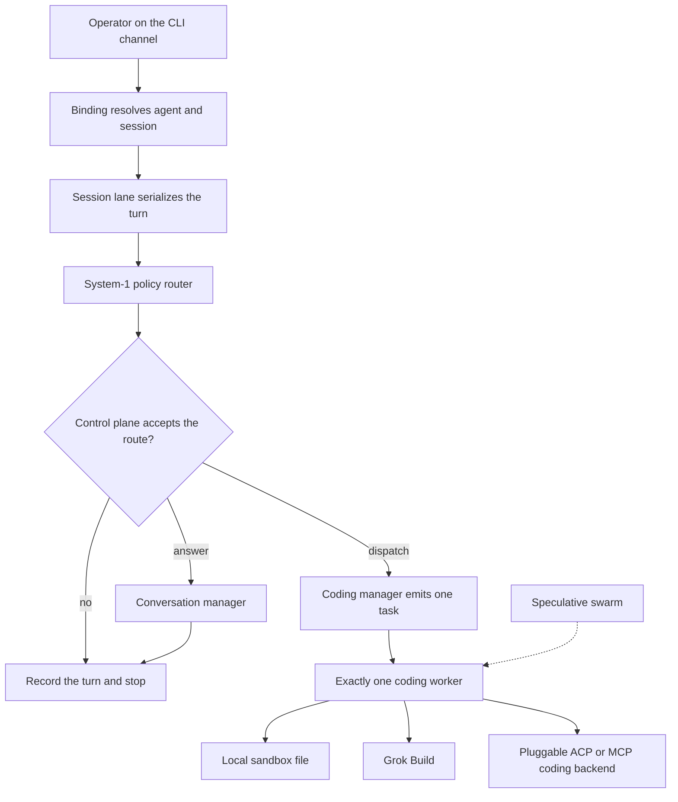

# Architecture

OpenCodingPartner is an orchestration mesh. The monument is the turn: a session lane, a System-1 route, a manager plan, and one coding worker. A chat transcript is a view of that turn. It is not the product.



The product has two OSS integrations: an OpenClaw-class gateway as the control plane, and Grok Build as the coding worker. A further coding backend may plug in through ACP or MCP. In v1 the named backend on that plug is Grok Build. The local sandbox worker is the offline stand-in, not a third upstream.

The swarm edge is drawn so the place it would attach is visible. `FOUNDATION_LIMITS.speculativeSwarm` is false, and the gateway rejects a plan with any task count other than one on a dispatch turn. The product maps the mesh as that gateway beside Grok Build.

## Roles

| Role | Decides | Does not |
| --- | --- | --- |
| Gateway | Session, binding, lane, whether a route may run, which single worker is called | Generate a plan or edit a file |
| System-1 router | Typed route: disposition, manager, worker, urgency, needs-human | Write prose or a diff. Laya is this role when weights are loaded |
| Conversation manager | A status reply when the route is `answer` | Dispatch a worker |
| Coding manager | One `write_file` task when the operator named the path and the bytes | Invent a change, call a second worker |
| Coding worker | Execute that task on one runtime | Choose the lane |

Chat LLMs, when they arrive, are managers. Grok Build workers implement the plan, and the local sandbox worker does that offline. Laya stays on the route. That split is the multi-weight design: the ~421M decision engine is System-1 only.

## Ingress

The foundation has one binding, the same shape OpenClaw uses to map a channel account onto an agent:

| Channel | Account | Agent | Session key |
| --- | --- | --- | --- |
| `cli` | `local` | `board` | `agent:board:main` |

OpenClaw's published model is the reference for this table, not a library we embed. Their gateway is a long-lived process: one owner of sessions, a WebSocket control plane, and an `agent` RPC that returns a run id. See [Gateway architecture](https://docs.openclaw.ai/concepts/architecture), [multi-agent routing](https://docs.openclaw.ai/concepts/multi-agent), and the [agent loop](https://docs.openclaw.ai/concepts/agent-loop). Phase 2 of the roadmap turns this in-process lane into that daemon. The turn order does not change when the transport does.

Turns on one session key run one at a time. A repeated idempotency key returns the stored successful turn and does not write again.

## Turn

1. Resolve the binding and enter the session lane.
2. Ask the policy router every route question in one `predict` call.
3. `evaluateRoute` accepts the answers or blocks the turn. A dispatch whose `needs_human` probability is 0.5 or higher does not run. Disagreeing labels do not run.
4. On `answer`, the conversation manager returns a status plan with zero tasks.
5. On `dispatch`, the coding manager returns a plan. The gateway allows that plan only when it contains exactly one `write_file` task and the worker id matches the route.
6. The gateway calls `CodingWorker.dispatch` once. That call site is `packages/gateway`.
7. A sandbox result must resolve inside the sandbox root. Then the turn is stored.

Decline and clarify stop before a manager plans a file. An unconfigured Grok Build worker throws before any process spawn; the turn is a failure and is not stored, so a later retry can proceed after the operator injects a runner.

Trace events on the turn: `session.resolved`, `policy.predicted`, `control.blocked` or `manager.planned`, `worker.skipped` or `worker.dispatched` plus `worker.finished`, then `turn.completed`.

## System-1 router

Questions use Laya's three public types (`choice`, `score`, `noul`). Answers use the public payload: `choice` plus `probabilities` and `confidence`, `score` plus `legend`, and `noul` as P(true). The Rust crate documents that shape in [`laya::Answer`](https://docs.rs/laya/latest/laya/enum.Answer.html). The Python quickstart is the same idea: `Router.predict(state, questions)` on [PyPI `laya` 0.3.7](https://pypi.org/project/laya/0.3.7/).

Checkpoints we will call, and do not bundle:

| Router name | Hub id | Size | Role here |
| --- | --- | --- | --- |
| `english` | `convaiinnovations/laya` | 421M, ModernBERT-large | Default for these English route questions |
| `multilingual` | `convaiinnovations/laya-multilingual` | 322M | When the operator's traffic is not English |
| `typed-decisions` | `convaiinnovations/laya-typed-decisions` | 421M | Only if a later question set matches that workflow |

The foundation process uses `MockLayaPolicyRouter`. `routing.backend` is `mock-heuristic`, `routing.repo` is null, and `usage` is zero tokens. The confidence figures are placeholders so the payload matches the schema. They are not a forward pass and they are not calibrated.

`LayaCheckpointRouter` is the seam. It calls a bridge and stamps `routing.backend = "laya"`. The bridge we ship is a command, not a spawn:

```text
python3 integrations/laya/predict.py
```

The script reads `{ "state", "questions", "model" }` on stdin and runs:

```python
from laya import Router
router = Router()
result = router.predict(state, questions, model=model)
```

`Router()` downloads Hub weights on first use inside the operator's environment. This repository does not call a hosted Laya URL.

If a live checkpoint returns labels the control plane does not accept, `evaluateRoute` blocks the worker. The gateway stays accountable when the model is confident and wrong.

## Managers

`parseManagerPlan` is the handoff. A plan that fails the parser never reaches a worker. Dispatch plans carry one task. The task path is sandbox-relative. Absolute paths and `..` segments fail in the parser and again in the worker before it writes.

The deterministic coding manager recognizes only:

```text
create RELATIVE_PATH with content:
<bytes>
```

A production manager is a chat model the operator configures. It must emit this same JSON. Free-form assistant text is not a plan.

## Workers

`CodingWorker` takes one `CodingDispatch` and returns a `WorkerResult`.

### Local sandbox

`LocalSandboxWorker` creates the sandbox directory, writes a sibling temporary file, and renames it into place. The gateway checks the returned absolute path is still inside the sandbox root.

### Grok Build

Grok Build is the Apache-2.0 coding-agent harness at [xai-org/grok-build](https://github.com/xai-org/grok-build). Headless mode is `grok -p "<prompt>" --output-format streaming-json` ([overview](https://docs.x.ai/build/overview), [headless guide](https://github.com/xai-org/grok-build/blob/main/crates/codegen/xai-grok-pager/docs/user-guide/14-headless-mode.md)). ACP (`grok agent stdio`) is the later bidirectional edge; the foundation records the headless argv first.

`buildGrokHeadlessInvocation` returns that argv and a cwd. `GrokBuildCodingWorker` runs it only through an injected `GrokBuildRunner`. This package does not import `node:child_process`, so a forgotten call cannot spawn `grok`.

## Limits that are on purpose

```typescript
ads: false
payments: false
speculativeSwarm: false
maxWorkersPerTurn: 1
```

`packs/enterprise` is a marker for a later consult or enterprise pack. It has no runtime, no price, and no meter.

## Independence

OpenCodingPartner does not ship OpenClaw, Grok Build, or Laya. It does not use their names as a certification. Operators who want those runtimes install them, accept their licenses, and supply their own credentials.
